## Self-introduction {.smaller}

:::: {.columns}
::: {.column .profile-column width="35%"}

{width=90%}

**Shiyi Li**

**李詩宜**

:::
::: {.column width="65%"}

#### Education background

- Ph.D. student in Journalism and Media Studies, The University of Hong Kong
- M.A. in Journalism and Communication, Tsinghua University
- B.A. in Journalism and Communication, Tsinghua University

#### Research interests

- Health communication
- Health-related stigma
- Media Psychology

:::
::::

## Warm up！！

### Quick Association Challenge

1. Words will appear on the screen one at a time.
2. Classify each word using the categories shown at the top.
3. **Raise your left or right hand** to indicate your choice, or simply decide in your mind.
4. Respond as **quickly and accurately** as possible.
5. The category pairings will change in the second round.

**No right or wrong feelings — just follow the classification rules!**

## Origin and History of Stigma {.smaller}

::: {.stigma-roots}

**PIE root** · *\*steig-* — "to stick; pointed"

**Greek** · *stigma* — "mark of a pointed instrument, puncture, tattoo-mark, brand,"

**Latin** · *stigma*

:::

:::: {.columns .stigma-history}
::: {.column width="52%"}

#### English · *stigma*

**1590s**

"mark made on skin by burning with a hot iron"

**1610s**

"mark of disgrace or infamy which attaches to a person on account of evil conduct"

:::
::: {.column width="48%"}

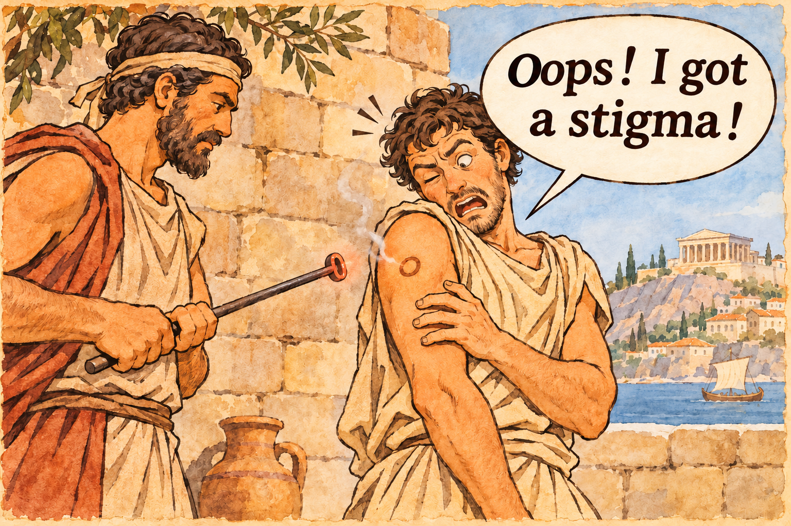{width=100%}

:::
::::

## Erving Goffman and His Classic Work {.smaller}

:::: {.columns .goffman-layout}
::: {.column .goffman-person width="46%"}

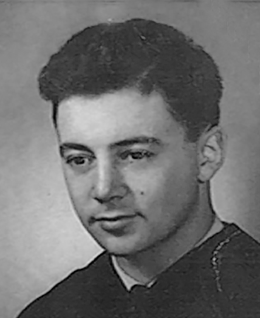{height=210px}

#### Erving Goffman

**1922–1982**

A Canadian-born American sociologist, social psychologist, and writer, considered by some "the most influential American sociologist of the twentieth century".

:::
::: {.column .goffman-works width="54%"}

#### Classic Works

His best-known contribution is his study of **symbolic interaction** and his 1956 book:

**1956** · ***The Presentation of Self in Everyday Life***

**1963** · ***Stigma: Notes on the Management of Spoiled Identity***

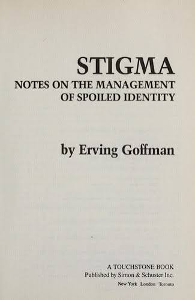{height=230px}

:::
::::

## Definition {.smaller}

::: {.definition-quote}

*“Society establishes the means of **categorizing persons** and the complement of **attributes** felt to be ordinary and natural for members of each of these categories......When a stranger comes into our presence, then, first appearances are likely to enable us to anticipate his category and attributes, his "social identity"......We lean on these anticipations that we have, transforming them into **normative expectations**......his possessing an attribute that makes him different from others in the category...... a person who is quite thoroughly bad, or dangerous, or weak. He is thus reduced in our minds **from a whole and usual person to a tainted, discounted one.**”*

*— Goffman, 1963*

:::

## Definition {#definition-keywords .smaller}

:::: {.columns .keyword-layout}
::: {.column width="44%"}

#### Keyword:

- social categorization
- social identity
- attribute
- relationship
- expectation violation

:::
::: {.column width="56%"}

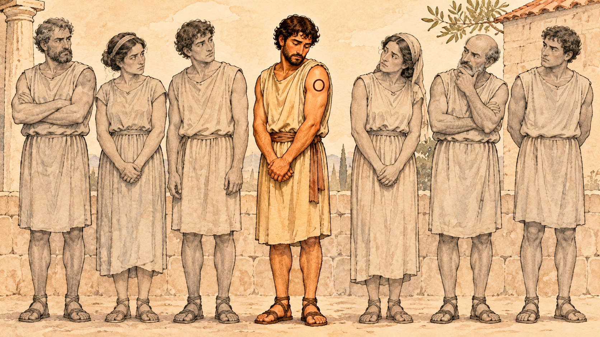{width=100%}

:::
::::

## Why Is Stigma So Hard to Remove? A Sociological Perspective {#stigma-persistence .smaller}

:::: {.columns .sociology-columns}
::: {.column width="33%"}

#### Cognitive categorization

We habitually categorize people, simplifying complex individuals into familiar social labels.

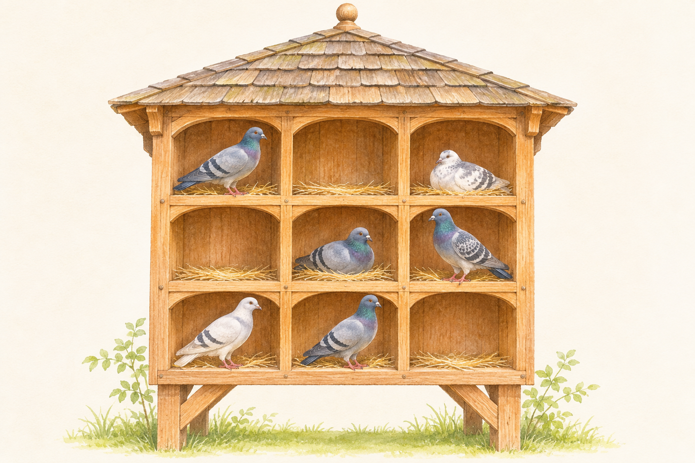{width=100%}

:::
::: {.column width="34%"}

#### Maintaining boundaries

Seeing others as “abnormal” reinforces our sense of being “normal.”

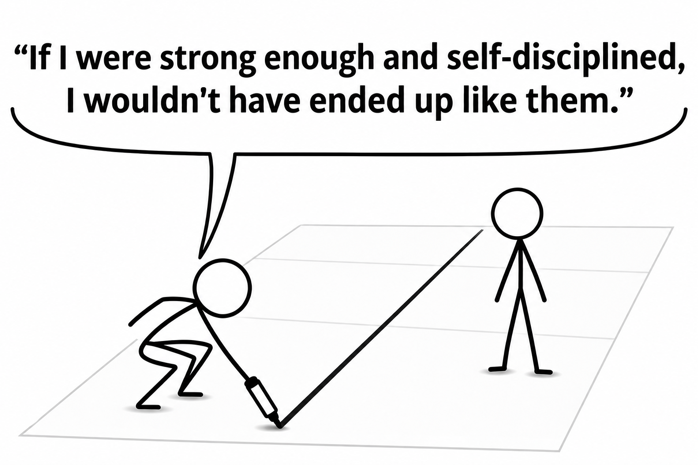{width=100%}

:::
::: {.column width="33%"}

#### Social reinforcement

Everyday language, media narratives, and organizational practices repeatedly reproduce and reinforce these labels.

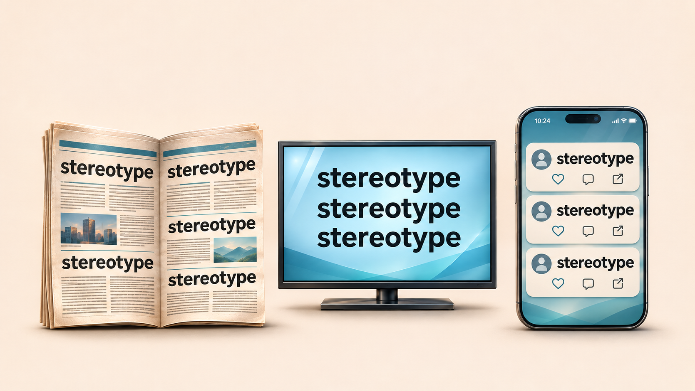{width=100%}

:::
::::

## Why Are Anti-Stigma Campaigns So Challenging? {#campaigns-complexity .smaller}

::: {.campaign-opinions}

### Common misconceptions

- “You have too much time on your hands.”
- “Just be more positive.”

### A biomedical response

- “Depression is an illness—not a personal failing.”
- “You cannot simply ‘cheer up’ and recover.”

**But does emphasizing biology always reduce stigma?**

:::

## Why Are Anti-Stigma Campaigns So Challenging? {#biological-debate .smaller}

::::: {.debate-content}

### Biological explanations: less blame, greater difference?

:::: {.columns .debate-columns}
::: {.column width="60%"}

#### Potential benefit: less blame

“It's beyond their control.”

Biological explanations may reduce personal blame.

#### Potential risk: essentialism

“They are fundamentally different.”

Biological explanations may reinforce an “us vs. them” divide.

:::
::: {.column width="40%"}

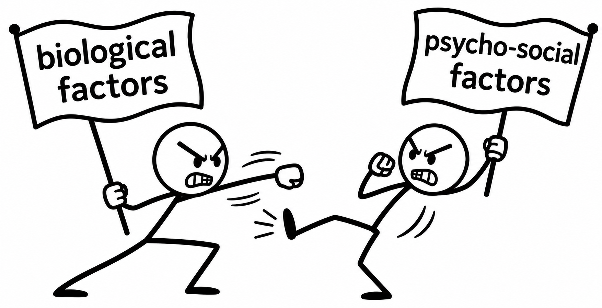{width=100%}

:::
::::

:::::

## Why Are Anti-Stigma Campaigns So Challenging? {#continuum-beliefs .smaller}

::::: {.continuum-content}

### Us vs. Them—Promoting Continuum Beliefs as a Campaign

:::: {.columns .continuum-images}
::: {.column width="50%"}

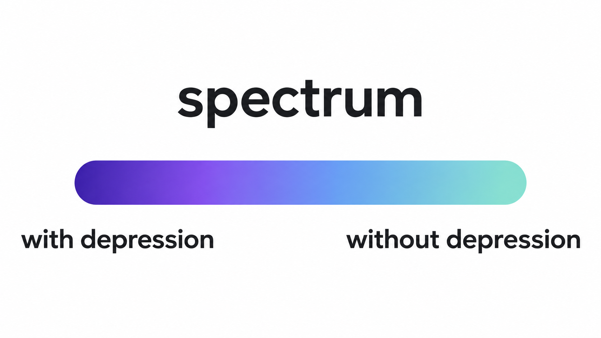{width=100%}

:::
::: {.column width="50%"}

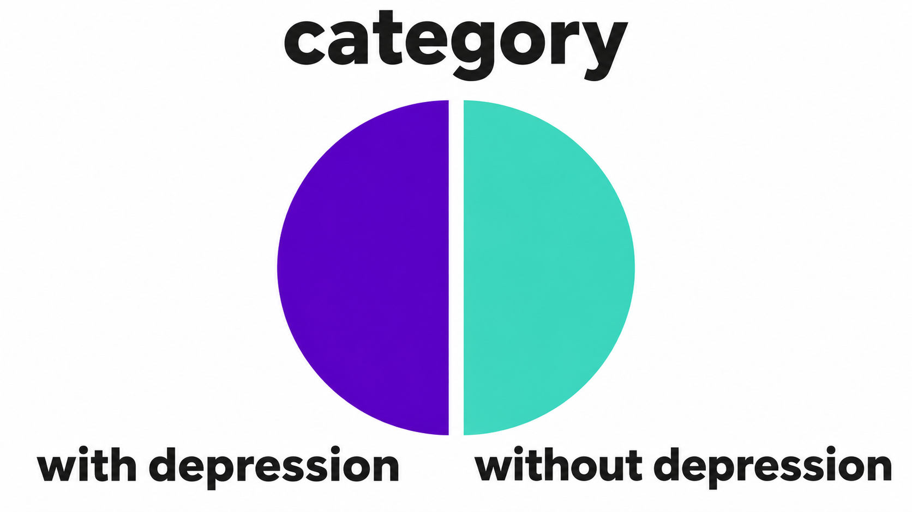{width=100%}

:::
::::

:::::

## Would a Smile Change Your First Impression? {#study-design .smaller}

::::: {.class-study .study-materials}

One profile describing depression. **Four photo versions.**

| Color tone | Positive expression | Negative expression |
|:---|:---:|:---:|
| **Warm** | 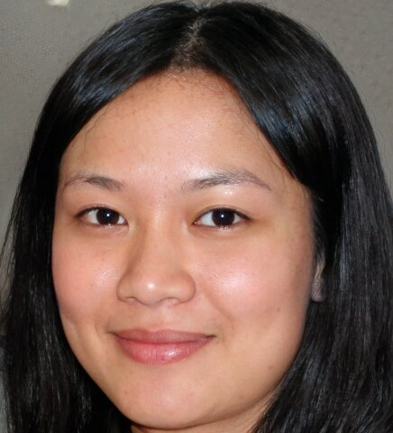{height=135px} | {height=135px} |
| **Cool** | {height=135px} | {height=135px} |

Each participant saw **one version at random**, then rated the person and their own reactions.

**Your prediction**

:::::

<!-- Teaching note: From my master's research. These are the actual photo stimuli, shown in simulated social media profiles. Warm/cool refers to color temperature, not perceived friendliness. Measures included perceived warmth, competence, emotions and discriminatory intentions. -->

## What Did We Find? {#study-findings .smaller}

::: {.class-study .study-takeaways}

### Expressions mattered

Positive expressions prompted **warmer, more capable** impressions.
Color tone showed **no clear effect** on these impressions.

### Perceived capability changed the pattern

Warmth's link to **less discrimination** was stronger when the person seemed **less capable**.

:::

<!-- Teaching note: Results concern this study's self-reported discriminatory intentions, not observed discriminatory behavior. The warmth association weakened as perceived competence increased and was no longer statistically clear at high competence. Competence did not clearly predict negative emotions, and was associated with less pity. These measured perceptions should not be described as independently manipulated causes. -->

## Acceptance Can Come with Conditions {#study-meaning .smaller}

::: {.class-study .study-takeaways}

### A possible reading of the findings

**“We accept your depression... if you still look positive.”**

### Pity can coexist with stigma

Feeling sorry for someone may still mean seeing them as **less capable**.

### The campaign dilemma

Smiling images may invite acceptance, yet leave **less room for visible sadness**.

:::

<!-- Teaching note: The opening quotation summarizes a possible interpretation; it is not a verbatim participant statement. These are implications for discussion, not additional experimental results or a claim about all members of the public. -->

